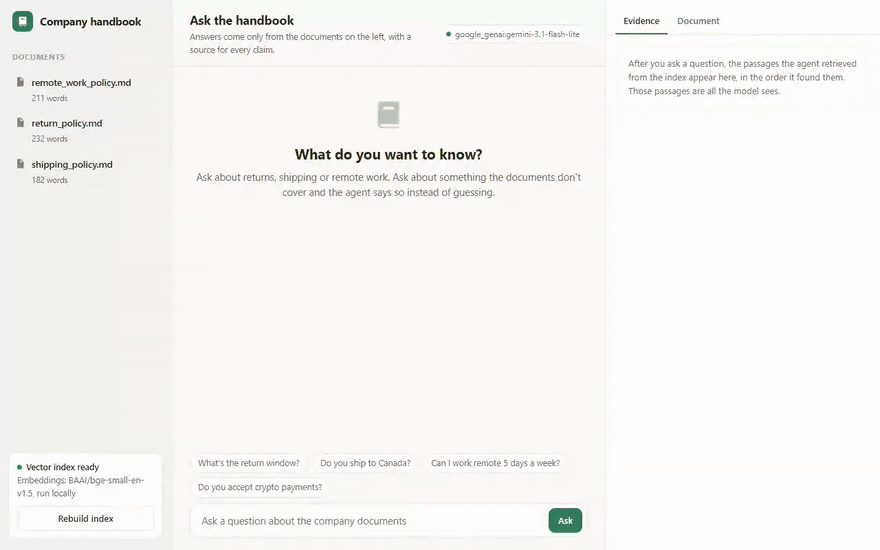

<h1>RAG Knowledge Base Agent</h1>

<b>Ask questions about your own documents. Every answer names the file it came from, or says plainly that the documents don't cover it.</b>

  
  
  
  
  
  

  <a href="#what-it-does">What it does</a> &nbsp;|&nbsp;
  <a href="#how-it-works">How it works</a> &nbsp;|&nbsp;
  <a href="#sample-run">Sample run</a> &nbsp;|&nbsp;
  <a href="#quick-start">Quick start</a> &nbsp;|&nbsp;
  <a href="#configuration">Configuration</a> &nbsp;|&nbsp;
  <a href="#roadmap">Roadmap</a>

 

<h2>See it in action</h2>

Recorded from a real run on Google Gemini (<code>gemini-3.5-flash</code>) on 12 November 2026. Nothing is edited or scripted. Only the waiting time while the model thinks is shortened. <a href="demo/demo.mp4">Download the MP4</a>.

<h2>The problem</h2>

Company knowledge lives in policies, handbooks and help docs that nobody can search quickly. Generic chatbots answer confidently from what they already know, which is not your policy.

A knowledge base assistant is only worth having if people can trust it. That means answers they can check, and an honest "I don't know" when the documents are silent.

<h2>What it does</h2>

<table>
  <tr><th align="left">Capability</th><th align="left">What that means in practice</th></tr>
  <tr><td><b>Your documents</b></td><td>Reads every <code>.md</code>, <code>.txt</code> and <code>.pdf</code> in <code>data/documents/</code>.</td></tr>
  <tr><td><b>Sources on every answer</b></td><td>Each answer cites the file it came from, so anyone can check it.</td></tr>
  <tr><td><b>Admits what it doesn't know</b></td><td>If the documents don't cover a question, it says so instead of guessing.</td></tr>
  <tr><td><b>Free, local embeddings</b></td><td>Documents are embedded on your own machine with FastEmbed. Indexing and search need no API key and cost nothing.</td></tr>
  <tr><td><b>Clean re-indexing</b></td><td>Add or change documents and rebuild. The old index is cleared first, so nothing is counted twice.</td></tr>
</table>

<h2>How it works</h2>

<pre>
build_index.py:  documents --&gt; chunks (800 chars) --&gt; local embeddings --&gt; Chroma index

ask.py:          question --&gt; embed --&gt; 4 closest chunks --&gt; model --&gt; answer + sources
</pre>

Documents are split into overlapping chunks and stored in a Chroma vector database on disk. When you ask a question, the four most relevant chunks are sent to the model with strict instructions to answer only from them and to cite the file.

Only the final answer step calls a paid model, so running costs stay low even with a large document set.

<h2>Decisions I made on purpose</h2>

<h3>"I don't know" is a feature</h3>

A RAG system that answers confidently from weak retrieval is worse than nothing. It looks authoritative and it is wrong, and the person asking can't tell. The prompt requires the model to admit gaps, and the citation rule makes an invented answer obvious, because there is nothing to point to.

<h3>Mixed sample documents</h3>

The samples are a shipping policy, a return policy and an internal remote-work policy. Customer-facing and internal documents are mixed on purpose, to show it isn't tuned to one kind of text.

<h2>Sample run</h2>

The first answer is from a real run on Google Gemini:

<pre>
$ python ask.py
You: How many days do I have to return an item?
Agent: You have 30 days from delivery to return an item for a full refund,
provided the item is unused, unworn, and in its original packaging with tags
attached (source: return_policy.md).
Sources: return_policy.md, shipping_policy.md

You: what's your policy on cryptocurrency payments
Agent: I don't have information about cryptocurrency payments in the
documents I have access to.
</pre>

<h2>Quick start</h2>

You need Python 3.12 or newer and an API key from OpenAI, Anthropic or Google Gemini.

<pre>
pip install -r requirements.txt
python build_index.py       # no API key needed
cp .env.example .env        # on Windows: copy .env.example .env
# open .env and paste your API key
python ask.py
</pre>

The first run downloads a small embedding model (about 80 MB). After that it starts quickly. To use your own documents, put them in <code>data/documents/</code> and run <code>build_index.py</code> again.

<h2>Configuration</h2>

Everything is set in <code>.env</code>. Copy <code>.env.example</code> to start.

<table>
  <tr><th align="left">Variable</th><th align="left">Required</th><th align="left">Purpose</th></tr>
  <tr><td><code>LLM_MODEL</code></td><td>Yes</td><td>Which model to use, as <code>provider:model</code>. Default <code>openai:gpt-5.5</code>. Also works with <code>anthropic:claude-opus-5-5</code> or <code>google_genai:gemini-3.5-flash</code>.</td></tr>
  <tr><td><code>OPENAI_API_KEY / ANTHROPIC_API_KEY / GOOGLE_API_KEY</code></td><td>One of them</td><td>The key for whichever provider you picked.</td></tr>
</table>

<h2>Project structure</h2>

<pre>
rag-knowledge-base-agent/
  .env.example                                           # copy to .env and add your key
  ask.py                                                 # question and answer chat
  build_index.py                                         # builds the vector index
  case_study.md                                          # longer write-up of the design
  README.md
  requirements.txt                                       # dependencies
  .git/
    COMMIT_EDITMSG
    config
    description
    HEAD
    hooks/applypatch-msg.sample
    hooks/commit-msg.sample
    hooks/fsmonitor-watchman.sample
    hooks/post-update.sample
    hooks/pre-applypatch.sample
    hooks/pre-commit.sample
    hooks/pre-merge-commit.sample
    hooks/pre-push.sample
    hooks/pre-rebase.sample
    hooks/pre-receive.sample
    hooks/prepare-commit-msg.sample
    hooks/push-to-checkout.sample
    hooks/sendemail-validate.sample
    hooks/update.sample
    index
    info/exclude
    logs/HEAD
    logs/refs/heads/main
    logs/refs/remotes/origin/main
    objects/0d/19a37d674a332b9dba9f34ec54f3144a81a21f
    objects/12/88821c81d3d64a429d61e6159f3218166314ea
    objects/18/004352a129397c3f4d2fe0ee4b76af55d6fda5
    objects/21/2fffe9b8501a836e93af9f6ed74307c137a83e
    objects/22/61de0576de55ab0166471018afa46a53e45d3d
    objects/32/a5a168939b8fb1ec689a6f9e84ccd5f0d4b73e
    objects/47/3070d02e45554f30e249cae5d33234db9f0fa6
    objects/78/998da0758f803a8b7d9b492206632524003f81
    objects/7a/3a4f0ab20b8170a7b714479283340f5fe09e10
    objects/7c/546a57758c1178c4c98fae1068264fff86b11f
    objects/8f/8b8931f8f6472d4c2b6923be797d1004b904b3
    objects/9a/d085a746f26e8591da976001e4c1598c5a1a0d
    objects/a1/10ce744d6c7ed8760da0b7e3ab5c79ca098577
    objects/a2/667477f906e25e4d46862b73a0cf1d10163a78
    objects/a3/621309df9f627f285cc3c11a052426cc1313ed
    objects/a5/3a6d356111eaaab97288368fc2051e158d4929
    objects/a8/7d854a7b9e8db4f5c1b2db59cc35853a602f87
    objects/bb/1d0d20270c6b562a687dd6c5e21f3c4d7ba090
    objects/bc/99adf171611781b0177021c5f2d4330bdd6d28
    objects/c3/794db7d19a5dfea2c3748af35affc2cf49d2e1
    objects/c5/4aeb32cf364cf433dfb7c8ce58583bc231b3a2
    objects/c5/97c23fa30e7a1e2dfac8278bb520f879e325c9
    objects/c9/3467f14da5a9bf8021b5eedbbd4b015f83633a
    objects/df/f173a640827c6933a74a716399dacd4a35b9cd
    objects/e6/9de29bb2d1d6434b8b29ae775ad8c2e48c5391
    objects/f0/94451ffb3b4caef3115ea6284799e216c88009
    objects/f2/37867b3ae68278b061d93e6d7e9954cfa1c1e6
    objects/fd/945af9ffb57dac2ee8d9117758e6a079e787a0
    refs/heads/main
    refs/remotes/origin/main
  agent/
    ingest.py                                            # loading, chunking and local embeddings
    llm.py                                               # picks the model from LLM_MODEL
    query.py                                             # retrieval and the answer prompt
  data/
    documents/                                           # sample policies, replace with your own
  demo/
    demo.gif
    demo.mp4
  tests/                                                 # pytest suite, runs without any API key
</pre>

<h2>Built with</h2>

Python &nbsp;&middot;&nbsp; LangChain &nbsp;&middot;&nbsp; Chroma &nbsp;&middot;&nbsp; FastEmbed &nbsp;&middot;&nbsp; pypdf &nbsp;&middot;&nbsp; OpenAI / Anthropic / Gemini

<h2>Tests</h2>

<pre>
pip install -r requirements-dev.txt
pytest
</pre>

Three tests cover document loading, rebuilding the index without duplicates, and answers coming back with their sources. They use a stand-in embedding model, so nothing is downloaded. None of the tests call a model or need an API key, so they run on GitHub Actions on every push. The badge at the top shows the latest result.

<h2>Roadmap</h2>

What I would build next if a client took this into production:

<ul>
  <li>A web chat interface, or Slack and Microsoft Teams bots, for internal use</li>
  <li>Syncing documents from Google Drive, Notion or SharePoint</li>
  <li>Access control, so each person only searches the documents they are allowed to see</li>
  <li>Incremental indexing for thousands of files, and better handling of tables</li>
  <li>A multilingual embedding model for documents in other languages</li>
</ul>

<h2>More from this series</h2>

Nine production-minded AI agents, each solving one business problem properly.

<table>
  <tr><td><a href="https://github.com/saqib-n/ai-research-report-agent"><b>Research Report Agent</b></a></td><td>Researches a topic, notices its own gaps, and writes a report with a source for every claim.</td></tr>
  <tr><td><a href="https://github.com/saqib-n/ai-sales-outreach-agent"><b>AI Sales Outreach Agent</b></a></td><td>Personalised cold emails and follow-ups, with a human approving every send.</td></tr>
  <tr><td><a href="https://github.com/saqib-n/ecommerce-automation-agent"><b>E-commerce Order and Inventory Agent</b></a></td><td>Shopify order, stock and returns assistant, plus a monitor that warns you before stock runs out.</td></tr>
  <tr><td><a href="https://github.com/saqib-n/email-triage-agent"><b>Email Triage Agent</b></a></td><td>Sorts an inbox into four buckets and gives each one a different level of autonomy.</td></tr>
  <tr><td><a href="https://github.com/saqib-n/lead-qualification-crm-agent"><b>Lead Qualification Agent</b></a></td><td>Scores inbound leads against your own rubric and pushes the good ones to HubSpot.</td></tr>
  <tr><td><a href="https://github.com/saqib-n/multi-agent-customer-support"><b>Multi-Agent Customer Support</b></a></td><td>A router plus specialist agents for orders, refunds, FAQs and human handoff.</td></tr>
  <tr><td><a href="https://github.com/saqib-n/recruiting-screening-agent"><b>Resume Screening Agent</b></a></td><td>Ranks resumes against a job description with evidence, and guards against common bias.</td></tr>
  <tr><td><a href="https://github.com/saqib-n/whatsapp-support-agent"><b>WhatsApp Support Agent</b></a></td><td>A WhatsApp Cloud API agent that checks orders, answers FAQs and escalates to a person.</td></tr>
</table>

<h2>Work with me</h2>

I'm Saqib Nawaz, founder of WolfXense AI. I build AI agents and automations for businesses, with Python, LangChain, LangGraph and n8n, and connect them to the tools teams already use, like CRMs, Shopify, Slack, email and WhatsApp.

If your team keeps asking the same questions your documents already answer, I can build this on your own files and put it where your team already works.

<a href="https://www.upwork.com/freelancers/~01de008504a38baf28"><b>Hire me on Upwork</b></a> &nbsp;|&nbsp; <a href="https://github.com/saqib-n"><b>More of my work on GitHub</b></a>

Released under the <a href="LICENSE">MIT License</a>. A longer write-up of the design is in <a href="case_study.md">case_study.md</a>.

